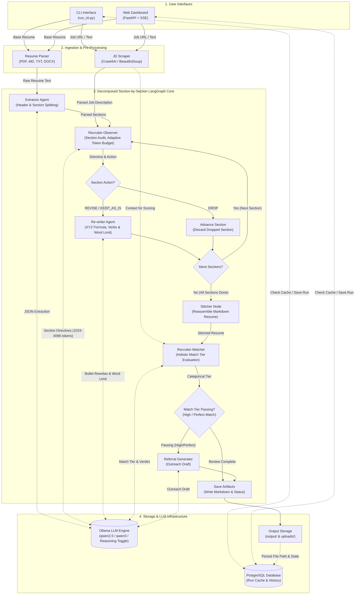

# Agentic Resume Rewriter

An intelligent, multi-agent CLI and Web application built on the **Decomposed Section-by-Section Evaluator-Optimizer pattern**. It automates ATS resume auditing, section-level optimization using industry-standard action verbs and the Google XYZ formula without hallucinations, strict bullet-pointer word limit enforcement, categorical match scoring, and high-impact referral reach-out generation.

---

## 1. Introduction

When applying for technical roles, resumes often fail initial automated or human screenings due to passive language, poor visual prioritization, missing metric framing, or mismatched phrasing. 

The **Agentic Resume Rewriter** addresses this by orchestrating a structured feedback loop between specialized AI agents powered by local LLMs via Ollama:
- **Extractor Agent:** Parses candidate header details (contact, links) and semantically decomposes the resume into discrete logical sections (Summary, Experience, Projects, Skills, Education).
- **Recruiter-Observer Agent (Section Evaluator):** Acts as a cold, deterministic (`temperature = 0.0`) ATS section auditor. For each section, it evaluates relevance against target Job Description (JD) criteria, assigns an action (`DROP`, `KEEP_AS_IS`, or `REVISE`), and produces surgical directives (`PRUNE BULLETS`, `REORDER BULLETS`, `REWORDING`). Incorporates adaptive token budgeting (1024 $\to$ 2048 $\to$ 4096 tokens) to reliably parse complex reasoning models without truncation.
- **Re-writer Agent (Section Optimizer):** Optimizes section bullets using the Google XYZ formula (`Accomplished [X] as measured by [Y], by doing [Z]`), a curated taxonomy of categorized action verbs, a strict zero-hallucination constraint, and strict per-pointer word limit enforcement (`WORD_LIMIT`). In `KEEP_AS_IS` sections, it audits all bullet pointers for word length and sharpens impact while preserving core content.
- **Stitcher Node:** Recombines the isolated candidate header with all surviving, rewritten sections into a clean, unified Markdown resume.
- **Recruiter-Matcher Agent (Holistic Evaluator):** Conducts an end-to-end audit of the fully stitched resume against the target JD, assigning a categorical match tier (`Irrelevant`, `Low Match`, `Average Match`, `High Match`, `Perfect Match`), highlighting key strengths, identifying remaining gaps, and providing a comprehensive recruiter verdict.
- **Referral Generator Agent:** Automatically triggers when the match tier reaches `High Match` or `Perfect Match` to draft a concise, high-converting outreach message under 100 words for LinkedIn or email.
- **Postgres Persistence & Caching:** Prevents redundant compute by caching application runs by `(Company, Job ID)`, supporting a `--force` flag for intentional re-runs.

---

## 2. System Architecture

The following diagram illustrates the decomposed section-by-section multi-agent architecture across ingestion, section iteration, holistic scoring, persistence, and local LLM inference:



### Component Communication Breakdown

- **User Interfaces (`run_cli.py` & `webapp/`)**: Accepts candidate resumes and job inputs (URL or raw text). Coordinates pre-flight health checks and performs instant cache lookups against PostgreSQL (`Company` + `Job ID`) to avoid redundant LLM invocations unless `--force` is specified.
- **Ingestion & Parsing (`parsers/` & `scrapers/`)**: `ResumeParser` extracts normalized text from `.pdf`, `.md`, `.txt`, and `.docx` documents. `JDScraper` uses Crawl4AI (headless Chromium) with JSON-LD schema parsing and SPA delay handling to extract clean job postings from career sites or local files.
- **Decomposed LangGraph Multi-Agent Core (`agents/`)**: Manages the section-by-section Evaluator-Optimizer pipeline via `StateGraph`:
  - **Extractor Agent (`extractor.py`):** Separates candidate header metadata and decomposes resume body into logical sections (`summary`, `experience`, `projects`, `skills`, `education`).
  - **Recruiter-Observer Agent (`observer.py`):** Cold section auditor (`temperature = 0.0`) that outputs `DROP`, `KEEP_AS_IS`, or `REVISE` actions along with explicit directives. Features adaptive token budgeting (1024 $\to$ 2048 $\to$ 4096) on parser failures to handle reasoning models without output clipping.
  - **Re-writer Agent (`rewriter.py`):** Optimizes bullets using categorized action verbs, Google XYZ metric structure, zero-hallucination constraints, and strictly enforces the pointer word limit (`WORD_LIMIT`). Pointers in `KEEP_AS_IS` sections are also audited for word limit and impact.
  - **Section Advancement & Stitcher (`stitcher.py`):** Advances index, drops irrelevant sections, and stitches all finalized sections with candidate header into a complete Markdown document.
  - **Recruiter-Matcher Agent (`matcher.py`):** Evaluates the final stitched resume against the JD, assigning a categorical match tier (`Irrelevant`, `Low Match`, `Average Match`, `High Match`, `Perfect Match`), strengths, gaps, and verdict.
  - **Referral Generator Agent (`referral.py`):** When candidate achieves `High Match` or `Perfect Match`, crafts a tailored, professional reach-out message.
  - **Artifact Saver (`save_artifacts_node`):** Exports the final Markdown resume to `output/` or `~/.resume-rewriter/output/` and records the final status (`MATCHED` or `REVIEW_COMPLETE`) in PostgreSQL.
- **Storage & External Infrastructure**:
  - **Ollama**: Provides private local inference for LLM prompts across all agent nodes, supporting configurable reasoning mode (`OLLAMA_REASONING`).
  - **PostgreSQL**: Stores execution state, audit logs, and history for the web archive.
  - **Output Artifacts**: Saves the final optimized Markdown resume to `output/<Company>_<JobID>_resume.md` and user uploads to `~/.resume-rewriter/uploads/`.

### Tech Stack & System Specifications

> These are specs on which the application has been built and tested.

#### Technology Stack & Versions
| Category | Component / Library | Version | Purpose |
| :--- | :--- | :--- | :--- |
| **Runtime** | Python | `3.10.12` | Core programming language runtime |
| **Agent Framework** | LangGraph | `1.2.15` | StateGraph orchestrator & cyclic Evaluator-Optimizer loop |
| **LLM Orchestration** | LangChain Core | `1.6.12` | Prompt templates, structured outputs, and chain execution |
| **LLM Integration** | LangChain-Ollama | `1.1.0` | Integration layer between LangChain and local Ollama |
| **Local LLM Engine** | Ollama | `0.40.5` | Local model inference hosting (`qwen2.5:7b` / `qwen3:8b`) |
| **Database** | PostgreSQL (`psql`) | `14.24` | Application state persistence, run history, and caching |
| **Database Driver** | Psycopg 3 | `3.2.0+` | PostgreSQL database adapter for Python |
| **Web Framework** | FastAPI | `0.143.3` | REST endpoints and Server-Sent Events (SSE) streaming |
| **ASGI Server** | Uvicorn | `0.54.0` | High-performance ASGI web server |
| **Web Scraping** | Playwright (Crawl4AI) | `1.64.0` | Dynamic headless Chromium browser rendering & job scraping |
| **HTML Parsing** | BeautifulSoup4 | `4.12.0+` | DOM extraction, text cleanup, and JSON-LD schema parsing |
| **Document Parsing** | PyPDF | `5.0.0+` | Candidate resume PDF parsing and text extraction |
| **CLI Framework** | Click | `8.5.0` | CLI argument and option parsing |
| **Terminal UI** | Rich | `15.0.0` | Terminal formatting, progress indicators, tables, and panels |
| **Configuration** | Pydantic / Pydantic-Settings | `2.14.1` / `2.15.0` | Typed settings management and environment loading |
| **Containerization** | Docker | `28.3.2` | Container platform for multi-container deployment |

#### Tested System Specifications (Hardware & Host OS)
| Specification | Details |
| :--- | :--- |
| **Operating System** | Ubuntu 22.04.5 LTS (x86_64, Linux Kernel `6.8.0-138-generic`) |
| **CPU** | 12th Gen Intel(R) Core(TM) i7-12700H (14 Cores / 20 Threads, up to 4.70 GHz) |
| **System Memory (RAM)** | 32 GB DDR (30 GiB usable) |
| **GPU / Acceleration** | NVIDIA RTX A2000 8GB Laptop GPU (Driver `570.158.01`, CUDA `12.8`) |
| **Storage Requirement** | ~15 GB free disk space (includes Playwright Chromium browser and local LLM weights) |

---

## 3. Directory Structure & Module Breakdown

```text
resume_rewriter/
├── config/
│   ├── __init__.py
│   ├── action_verbs.py          # Action verb taxonomy and categorized mappings
│   └── settings.py              # Dynamic configuration manager (supports ~/.resume-rewriter/config.env)
├── db/
│   ├── __init__.py
│   ├── schema.sql               # PostgreSQL DDL schema definition
│   ├── connection.py            # Database client and connection verification
│   └── operations.py            # Read/write queries, caching, history pagination, and state persistence
├── docker/                      # Containerization and multi-container deployment
│   ├── Dockerfile               # Slim Python 3.10 runtime with Playwright Chromium
│   ├── docker-compose.yml       # Orchestrates web app and GPU-accelerated Ollama
│   └── build.sh                 # Build script to generate container image
├── parsers/
│   ├── __init__.py
│   ├── base.py                  # Abstract Base Class for document parsing (BaseDocumentParser)
│   └── resume_parser.py         # Multi-format parser for PDF, Markdown, and TXT resumes
├── scrapers/
│   ├── __init__.py
│   └── jd_scraper.py            # Crawl4AI + BeautifulSoup async scraper for dynamic job boards
├── agents/
│   ├── __init__.py
│   ├── state.py                 # LangGraph AgentState TypedDict definition
│   ├── extractor.py             # Header isolation and section decomposition node
│   ├── observer.py              # Section recruiter evaluation node with adaptive token budgeting
│   ├── rewriter.py              # Bullet optimizer node (action verbs, XYZ formula, word limit)
│   ├── stitcher.py              # Section advancement, filtering, and final markdown assembly
│   ├── matcher.py               # Holistic recruiter evaluation node (categorical match tiers)
│   ├── referral.py              # Targeted referral reach-out generator node
│   ├── recruiter.py             # Legacy monolithic recruiter node
│   └── workflow.py              # LangGraph StateGraph assembly and conditional routing logic
├── webapp/                      # Web application backend and frontend assets
│   ├── __init__.py
│   ├── server.py                # FastAPI REST API, configuration endpoints, and static file server
│   ├── pipeline_runner.py       # Background worker and Server-Sent Events (SSE) stream manager
│   └── assets/                  # Frontend single-page app assets
│       ├── html/index.html      # Responsive Dark Mode dashboard with System Configuration drawer
│       ├── css/style.css        # Slate/cyan design system and glassmorphism styling
│       └── js/app.js            # Independent tab logic, SSE stream consumer, and lazy loader
├── output/                      # Default destination for generated Markdown resumes
├── bootstrap.py                 # System health-check utility with intelligent localhost fallback
├── run_gui.py                   # Root entry point to launch the interactive Web UI
├── run_cli.py                   # Click-based CLI entry point
├── requirements.txt             # Project dependencies
├── .dockerignore                # Build context allowlist filter
├── .env.example                 # Template environment variables
└── README.md                    # Project documentation
```

### Module Descriptions
- **`config/settings.py`**: Centralizes configuration (database credentials, Ollama endpoint, model tag, reasoning toggle, pointer word limits, and output directory) via `pydantic-settings`. Prioritizes user configuration in `~/.resume-rewriter/config.env` and supports hot-reloading.
- **`config/action_verbs.py`**: Categorized dictionary of active industry verbs used by the Re-writer Agent to inject metric-driven impact.
- **`db/`**: Handles database interactions. `schema.sql` manages table creation with columns for `match_tier`, `source_resume_path`, and `recruiter_verdict`. `operations.py` manages deduplication checks, cursor-based history pagination, and application state updates.
- **`docker/`**: Contains containerization and deployment assets. `Dockerfile` packages the application on a slim Python 3.10 runtime with Playwright Chromium; `docker-compose.yml` orchestrates the web dashboard alongside a GPU-accelerated Ollama container; and `build.sh` automates image compilation.
- **`parsers/`**: An extensible document extraction suite. `resume_parser.py` extracts text from `.pdf`, `.md`, and `.txt` files.
- **`scrapers/jd_scraper.py`**: Robust crawler built on `Crawl4AI` (headless Chromium) and `BeautifulSoup`. Features automatic extraction of structured `JobPosting` schema (`application/ld+json`), SPA render delay support, and heuristic DOM fallback to handle modern ATS platforms (Workday, Phenom People, Greenhouse, Lever).
- **`agents/`**: Contains the core decomposed intelligence:
  - `state.py`: Defines the typed payload (`AgentState`) passed through the agent graph.
  - `extractor.py`: Extracts contact header information and breaks raw resume text into distinct sections.
  - `observer.py`: Evaluates section relevance and issues structured revision directives with adaptive token retry (1024 $\to$ 2048 $\to$ 4096 tokens).
  - `rewriter.py`: Applies action verbs, XYZ metric framing, and enforces the pointer word limit.
  - `stitcher.py`: Advances section pointers and stitches surviving sections back together.
  - `matcher.py`: Grades the full stitched resume into categorical match tiers (`Irrelevant` through `Perfect Match`).
  - `referral.py`: Crafts targeted LinkedIn/email outreach drafts.
  - `workflow.py`: Compiles the `StateGraph` that manages section looping, conditional branching, and file export.
- **`webapp/`**: Encapsulates the Web UI server and frontend. `server.py` provides REST and SSE streaming endpoints; `pipeline_runner.py` decouples LLM execution into non-blocking background tasks; `assets/` contains the vanilla HTML, CSS, and JS.
- **`run_gui.py`**: The clean root launcher to start the Web UI dashboard on `http://localhost:8000`.
- **`bootstrap.py`**: Validates that external dependencies (PostgreSQL and Ollama) are online and configured before agent execution starts, with automatic fallback resolution between `host.docker.internal` and `localhost`.
- **`run_cli.py`**: The CLI interface. Provides option parsing, status tables, and error diagnostics using `rich`.

---

## 4. Setup Steps

### 4.1. Database Setup (PostgreSQL)

1. Install PostgreSQL through your OS package manager (`brew install postgresql` on macOS, `apt install postgresql` on Ubuntu).
2. Start the service:
   ```bash
   sudo systemctl start postgresql   # Linux
   brew services start postgresql    # macOS
   ```
3. Create the database:
   ```bash
   createdb -U postgres resume_rewriter_db
   ```

#### Initialize the Schema
Run the provided SQL script to build the tables and indexes:
```bash
psql -h localhost -p 5432 -U postgres -d resume_rewriter_db -f db/schema.sql
```

---

### 4.2. Ollama & LLM Setup

The application is configured by default for `qwen2.5:7b`, but works with larger variants (`qwen2.5:14b`, `qwen2.5:32b`) as well.

#### Option A: Native System Service

1. **Install Ollama:**
   - **Linux / macOS:** Run `curl -fsSL https://ollama.com/install.sh | sh`
   - **Windows:** Download the installer from the [official Ollama website](https://ollama.com).
2. **Start the Service:**
   - Ollama usually runs in the background automatically. To start manually:
     ```bash
     ollama serve
     ```
3. **Pull the Model:**
   ```bash
   ollama pull qwen2.5:7b
   ```

#### Option B: Docker Container

##### 1. With GPU Acceleration (NVIDIA)
Ensure you have the [NVIDIA Container Toolkit](https://docs.nvidia.com/datacenter/cloud-native/container-toolkit/latest/install-guide.html) installed.
```bash
docker run -d \
  --gpus=all \
  -v ollama_storage:/root/.ollama \
  -p 11434:11434 \
  --name ollama_gpu \
  ollama/ollama

# Download the model inside the container
docker exec -it ollama_gpu ollama pull qwen2.5:7b
```

##### 2. CPU Only
```bash
docker run -d \
  -v ollama_storage:/root/.ollama \
  -p 11434:11434 \
  --name ollama_cpu \
  ollama/ollama

# Download the model inside the container
docker exec -it ollama_cpu ollama pull qwen2.5:7b
```

---

### 4.3. Python Environment Setup

Requires **Python 3.10+**.

1. **Clone the repository and set up a virtual environment:**
   ```bash
   git clone <repo-url>
   cd resume_rewriter

   python3 -m venv venv
   source venv/bin/activate  # On Windows: venv\Scripts\activate
   ```

2. **Install Python dependencies:**
   ```bash
   pip install --upgrade pip
   pip install -r requirements.txt
   ```

3. **Install Crawl4AI Browser Dependencies:**
   `Crawl4AI` requires Playwright headless browser binaries to render dynamic job portals:
   ```bash
   playwright install chromium
   ```

---

### 4.4. Environment Variables (`.env`)

Create your `.env` configuration file from the provided template:
```bash
cp .env.example .env
```

Edit `.env` to match your environment:
```ini
# Ollama Configuration
OLLAMA_BASE_URL=http://localhost:11434
OLLAMA_MODEL=qwen2.5:7b
OLLAMA_REASONING=false

# PostgreSQL Database Configuration
POSTGRES_HOST=localhost
POSTGRES_PORT=5432
POSTGRES_DB=resume_rewriter_db
POSTGRES_USER=postgres
POSTGRES_PASSWORD=postgres

# Content & Rewriter Constraints
WORD_LIMIT=20
```

| Variable | Description |
| :--- | :--- |
| `OLLAMA_BASE_URL` | Endpoint of the Ollama server (native or container). Default: `http://localhost:11434`. |
| `OLLAMA_MODEL` | Local LLM tag (e.g., `qwen2.5:7b`, `qwen3:8b`). |
| `OLLAMA_REASONING` | Toggle thinking/reasoning mode for reasoning models (e.g., Qwen 3). Default: `false`. Can also be set via `REASONING`. |
| `POSTGRES_*` | Connection credentials for the application database. |
| `WORD_LIMIT` | Maximum word count per pointer in the rewritten resume. Default: `20`. |

---

### 4.5. Docker Build & Deployment

As an alternative to native local Python setup, you can build and run the application and its LLM backend using Docker and Docker Compose.

#### 1. Build the Application Image
The container uses `python:3.10-slim` and installs all project requirements along with Playwright Chromium for web scraping. Run `build.sh` from the `docker/` directory:

```bash
cd docker
./build.sh
```
This builds and tags the image as `resume-rewriter:latest` using the repository root as the build context.

#### 2. Deploy with Docker Compose
Deploy both the Web UI and the Ollama service with NVIDIA GPU support:

```bash
# From the docker/ directory
docker compose up -d
```
*(Or from the repository root: `docker compose -f docker/docker-compose.yml up -d`)*

#### Services in `docker-compose.yml`:
* **`web`**: Runs `run_gui.py` on port `8000`. Maps `host.docker.internal` to `host-gateway` so the container can communicate with services running on the host machine. Mounts `~/.resume-rewriter` to `/root/.resume-rewriter` to persist uploaded resumes and user settings.
* **`ollama_gpu`**: Runs the official `ollama/ollama` image with NVIDIA GPU acceleration (`--gpus all`) on port `11434`, storing models persistently in the `ollama_storage` volume.

#### 3. Pull Model in Containerized Ollama
If using the containerized `ollama_gpu` service, pull your preferred model once the container is running:
```bash
docker exec -it ollama_gpu ollama pull qwen2.5:7b
```

#### 4. Access the Web Dashboard
Open **[http://localhost:8000](http://localhost:8000)** in your browser.

#### 5. Stop the Containers
```bash
# From the docker/ directory
docker compose down
```

---

## 5. Run Methodology

### Step 1: Run Pre-flight Health Checks
Before starting a full run, verify that your local systems (PostgreSQL, Ollama, model availability) are operational:
```bash
python bootstrap.py
```
If any system is unreachable or uninitialized, the diagnostic table will highlight the problem with troubleshooting steps.

---

### Step 2: Running the CLI (`run_cli.py`)

#### Command Line Options
```text
Options:
  -r, --resume PATH               Path to base candidate resume (.pdf, .md,
                                  .txt, or .docx).  [required]
  -c, --company TEXT              Name of the hiring company (e.g.,
                                  'Mastercard').  [required]
  -j, --job-id TEXT               Unique requisition ID or code (e.g.,
                                  'MAS-101').  [required]
  --role TEXT                     Target job title (e.g., 'Senior AI
                                  Engineer').  [required]
  -u, --url TEXT                  Public URL to the job posting (scraped via
                                  Crawl4AI).
  --jd-file PATH                  Local path to a text/markdown file
                                  containing the JD.
  -f, --force                     Force re-execution even if the job posting
                                  was already processed in the database.
  -i, --instructions TEXT         General auxiliary instructions for all
                                  agents (text string or path to a .txt file).
  --recruiter-instructions, --recruiter-inst TEXT
                                  Specific guidance for Recruiter-Observer and
                                  Matcher agents (text string or file path).
  --rewriter-instructions, --rewriter-inst TEXT
                                  Specific guidance for Section Re-writer
                                  agent (text string or file path).
  --referral-instructions, --referral-inst TEXT
                                  Specific guidance for Referral agent (text
                                  string or file path).
  -w, --word-limit INTEGER        Maximum word limit per pointer in the resume
                                  (overrides WORD_LIMIT env setting).
  --skip-bootstrap                Skip pre-flight health checks for Ollama and
                                  PostgreSQL.
  --help                          Show this message and exit.
```

---

### Step 3: Common Execution Scenarios

#### Scenario A: Using a Live Job Posting URL
```bash
python run_cli.py \
  --resume "data/my_base_resume.pdf" \
  --company "Datadog" \
  --job-id "ENG-4491" \
  --role "Senior Backend Engineer" \
  --url "https://careers.datadog.com/detail/12345"
```
*The scraper launches a headless Chromium instance, strips web noise, isolates the candidate header, decomposes the resume into logical sections, audits and rewrites bullet points section-by-section adhering to word limits, stitches the complete resume, evaluates overall match tier, and saves the Markdown resume under `output/`.*

#### Scenario B: Using a Local Job Description File
Useful when applying to private job portals or internal transfers:
```bash
python run_cli.py \
  --resume "data/my_base_resume.md" \
  --company "Stripe" \
  --job-id "REQ-9920" \
  --role "Staff Infrastructure Engineer" \
  --jd-file "data/stripe_jd.txt" \
  --word-limit 20
```

#### Scenario C: Idempotency Caching & Overriding (`--force`)
If you run the CLI with an identical `--company` and `--job-id` combination:
```bash
# 1. Normal run (Returns cached score, saved file path, and referral message immediately)
python run_cli.py \
  --resume "data/my_base_resume.md" \
  --company "Stripe" \
  --job-id "REQ-9920" \
  --role "Staff Infrastructure Engineer" \
  --jd-file "data/stripe_jd.txt"

# 2. Forced re-run (Bypasses cache, clears old result, and re-executes the agent loop)
python run_cli.py \
  --resume "data/my_base_resume.md" \
  --company "Stripe" \
  --job-id "REQ-9920" \
  --role "Staff Infrastructure Engineer" \
  --jd-file "data/stripe_jd.txt" \
  --force
```

#### Scenario D: Providing Agent-Specific Auxiliary Guidance (Highest Priority)
Steer specific agents individually or supply general guidance (as inline strings or paths to `.txt` files). Any provided auxiliary prompt takes highest priority over standard agent defaults:
```bash
python run_cli.py \
  --resume "data/my_base_resume.pdf" \
  --company "Adobe" \
  --job-id "R171487" \
  --role "Machine Learning Engineer" \
  --url "https://careers.adobe.com/us/en/job/ADOBUSR171487EXTERNALENUS/Machine-Learning-Engineer-3" \
  --recruiter-instructions "Treat abstract ML systems background as transferable to generative AI pipelines; calibrate for Staff-level depth." \
  --rewriter-instructions "Emphasize PyTorch distributed training and inference latency metrics; maintain concise XYZ bullet points." \
  --referral-instructions "Keep note under 70 words; mention shared enthusiasm for Adobe Firefly." \
  --word-limit 25
```

---

## 6. Output Artifacts

Upon completion of a successful run:
1. **Optimized Resume File**: A structured Markdown resume is generated at:
   ```text
   output/<Company>_<JobID>_resume.md
   ```
   *(or at `~/.resume-rewriter/output/<Company>_<JobID>_resume.md`)*
2. **Referral Message**: If the match tier reaches `High Match` or `Perfect Match`, a customized reach-out message is printed directly to the terminal for easy copying.
3. **Database Record**: All execution details (categorical `match_tier`, `recruiter_verdict`, `status` (`MATCHED` or `REVIEW_COMPLETE`), file paths, and referral messages) are updated in the `job_applications` PostgreSQL table.

---

## 7. Interactive Web UI Dashboard

A modern, dark-themed Web UI is available to interactively tailor resumes and review history:

```bash
python run_gui.py
```
Open **[http://localhost:8000](http://localhost:8000)** in your browser.

### Key Features
* **Tab 1: Generate Resume (Live Pipeline Stream):**
  * Drag & drop candidate base resume (`.pdf`, `.md`, `.txt`, `.docx`) — automatically saved to `~/.resume-rewriter/uploads/` for side-by-side version comparison.
  * Enter Target Company, Requisition ID, and Target Role.
  * Ingest Job Description via **URL Web Scrape** (Crawl4AI with JSON-LD schema parsing and SPA render delays) or **Direct Text / Paste**.
  * **Agent Guidance & Instructions (Optional):** Interactive segmented selector allowing agent-specific guidance (Recruiter-Observer / Matcher, Re-writer, Referral) as well as general fallback instructions. Any provided auxiliary prompt takes highest priority during agent execution. Indicator dots highlight configured tabs.
  * **Live Stepper & Status (SSE):** Real-time Server-Sent Events stream reflecting each decomposed pipeline stage:
    1. *Bootstrap Health Checks & Cache Verification*
    2. *Extraction & Section Splitting*
    3. *Recruiter-Observer Section Audits (with adaptive token budgeting)*
    4. *Re-writer Bullet Optimization (action verbs, XYZ formula, word limit enforcement, KEEP_AS_IS impact audits)*
    5. *Section Stitching & Document Reassembly*
    6. *Recruiter-Matcher Holistic Evaluation (Categorical Match Tier, Strengths, Gaps, Verdict)*
    7. *Referral Outreach Generation (for passing tiers)*
    8. *Artifact Saving & Database State Persistence*
* **Tab 2: History (Interactive Run Archive):**
  * **Fully Independent:** Switching between tabs does not disrupt an ongoing generation task.
  * **Lazy Loading:** Automatically fetches past applications sorted newest-first in batches of 15 records as you scroll.
  * **Search Bar:** Instantly filter runs by Company, Role, or Requisition ID.
  * **Inspection Modal:** Click any card to review full Job Details, the Categorical Match Tier badge (`Irrelevant`, `Low Match`, `Average Match`, `High Match`, `Perfect Match`), the Recruiter Audit Verdict, and the drafted Referral Message (with 1-click clipboard copy).
  * **Document Viewer:** Switch between **Rewritten Resume**, **Original Upload**, and a **Side-by-Side Comparison Diff** with full Markdown syntax highlighting and PDF preview.
* **System Settings Drawer (Top-Right Gear Icon):**
  * Edit Ollama host/model, Model Reasoning mode (`OLLAMA_REASONING`), Re-writer Word Limit (`WORD_LIMIT`), and PostgreSQL credentials directly from the browser.
  * Persisted to `~/.resume-rewriter/config.env` and reused across all runs without needing to touch project files or restart the server.
  * **Test Connections:** Live connectivity validator for PostgreSQL and Ollama with status indicators.

---

## 8. Troubleshooting & FAQs

### 8.1. "Service Issue" Status Badge in UI
* **Ollama Host Resolution:** On native Linux, Ollama runs on `http://localhost:11434` (or `http://127.0.0.1:11434`), while `http://host.docker.internal:11434` is only routable inside Docker containers. `bootstrap.py` automatically resolves and falls back to `localhost:11434`.
* **Hovering Details:** Hover over or click the health pill in the top header (`System Ready` / `Service Issue`) to see exact diagnostic messages for both PostgreSQL and Ollama.
* **Model Readiness:** Ensure the model specified in settings (e.g. `qwen2.5:7b` or `qwen3:8b`) is pulled locally via `ollama pull <model-name>`.

### 8.2. PostgreSQL Connection Failures
* Ensure PostgreSQL is running (`sudo systemctl status postgresql` or `pg_isready`).
* Verify that the database and user match your `~/.resume-rewriter/config.env` settings.
* Test connectivity using `./env_rr/bin/python bootstrap.py` or the **Test Connections** button in the Web UI Settings drawer.

### 8.3. Force Re-running Cached Applications
* If an application was already evaluated for a given Company and Job ID, the system caches the result to avoid redundant compute.
* In the CLI: Add the `--force` / `-f` flag.
* In the Web UI: Expand the **Advanced Run Configuration** accordion and check **Force re-execution if cached**.

### 8.4. Playwright Headless Chromium Missing
* If scraping fails with `BrowserType.launch: Executable doesn't exist`, install the required headless browser binaries within your active environment:
  ```bash
  playwright install chromium
  ```

### 8.5. Crawl4AI Cache "attempt to write a readonly database"
* If switching between Docker (which runs as root) and local virtual environments, Crawl4AI cache directories under `~/.resume-rewriter/.crawl4ai` may inherit root permissions. Fix ownership with:
  ```bash
  sudo chown -R $USER:$USER ~/.resume-rewriter
  ```

### 8.6. Reasoning Models & Token Exhaustion
* When using reasoning models (such as `qwen3:8b`), model thinking tokens in `<think>...</think>` can consume the output budget before JSON formatting begins, leading to `OutputParserException` or empty JSON strings.
* **Recommended Resolution:** In the Web UI System Settings drawer or `.env`, set `OLLAMA_REASONING=false` to disable thinking tokens for fast, deterministic, and direct JSON parsing.
* **Adaptive Token Budgeting:** If reasoning is enabled, the Recruiter-Observer agent automatically handles parser exceptions by doubling the token prediction limit across retry attempts (`num_predict`: 1024 → 2048 → 4096 tokens).
